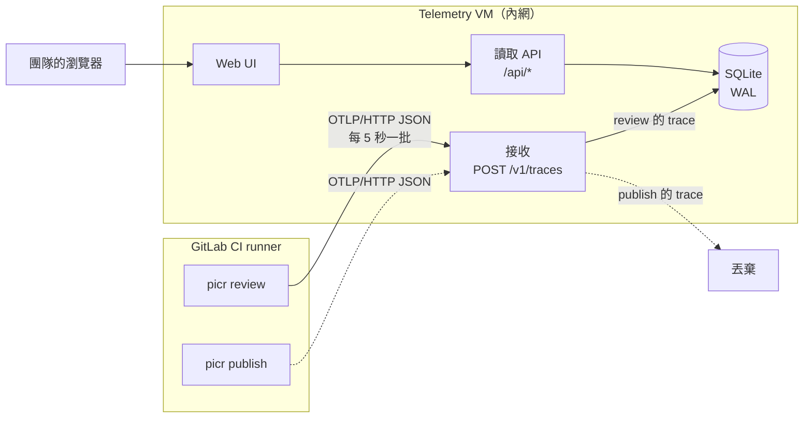

# picr Telemetry 伺服器設計

狀態：草稿，待討論。日期：2026-11-27。CLI 端：pi-code-review PR #79（`export-review-traces`）。

## 目標與範圍

pi-code-review（`picr`）的 `review` 和 `publish` 每次執行會送出一棵 OpenTelemetry trace。本專案接收這些 trace，並提供給團隊看的 web UI。本專案只處理 `review` 的 trace。

這個伺服器要回答的問題：一次 review 花了多少時間和 token、時間花在哪個步驟、每個 agent 讀了哪些檔案、模型回了什麼、哪些 finding 在哪一步被丟掉，以及同一個 MR 多次 review 的差異。

### 已確定的決定

- 獨立的 repository（本 repo）。
- 接收用 port `4318`，UI 和 API 用 port `8080`。
- 前端用 React + Vite。
- 用 OpenSpec 管理變更。
- TypeScript + SQLite。
- 部署在一台獨立的 VM，和 GitLab 在同一個內網。
- 團隊使用，UI 不做登入。
- CLI 不寫死伺服器位置：在 GitLab 的 instance 或 group 層級設定 CI/CD 變數 `OTEL_EXPORTER_OTLP_ENDPOINT`。
- 接收端第一版不驗證 token。
- 只處理 `review` 的 trace。`publish` 的 trace 先不處理：接收時丟棄，不儲存也不顯示。

### 不在範圍內

- 登入、帳號、依專案的權限。
- OTLP logs 和 metrics（CLI 只送 traces）。
- 告警與通知。
- 多個伺服器的水平擴充。
- `publish` 的 trace，以及 review 和 publish 之間的連結。之後要做時，CLI 端已經會送，不用改 CLI。

## 架構與部署



決定：CLI 直接送到伺服器，前面不放 OpenTelemetry Collector。一次 review 大約 1,000 個 span，量很小，少一個元件比較好維護。之後量變大，或要同時送到別的系統，再在前面加 Collector，CLI 不用改。

### 部署

- 一個 Node 程序，同時提供接收、API 和 UI 的靜態檔。
- 接收用 port `4318`（OTLP/HTTP 的慣用 port），UI 和 API 用 port `8080`。分開的好處：防火牆可以只對 GitLab runner 開 `4318`，只對團隊的網段開 `8080`。
- GitLab 變數：`OTEL_EXPORTER_OTLP_ENDPOINT=http://<VM 位址>:4318`。CLI 會送到 `/v1/traces`。
- SQLite 檔放在 VM 的本機磁碟，每天備份一次。

## CLI 送來的資料

CLI 的 trace 結構在 pi-code-review 的 `openspec/specs/review-tracing/spec.md` 定義，詳細清單見其 `docs/customization.md` 的 Tracing 一節。本伺服器只依賴下列名稱，不依賴 CLI 的程式碼。

| Span 名稱 | 父 span | 伺服器用到的屬性 |
| --- | --- | --- |
| `picr.review` | 無（root） | `picr.source.*`（host、projectId、mergeRequestIid）、`picr.snapshot.headSha`、`picr.model`、`picr.language`、`picr.result.*` |
| `picr.step.<name>` | `picr.review` | `picr.step`、`picr.findings.before`、`picr.findings.after` |
| `picr.agent_run` | 步驟 | `picr.agent.kind`、`picr.focus`、`picr.file`、`picr.batch`、`picr.try`、`picr.prompt.system`、`picr.prompt.user` |
| `picr.model_request` | `picr.agent_run` | `model`、`usage.input`、`usage.output`、`usage.cache_read`、`cost.total`、`stop` |
| `picr.tool_call` | `picr.agent_run` | `picr.tool.name`、`picr.tool.path`、`picr.tool.result`、`picr.tool.error` |
| `picr.host_request` | root | `http.request.method`、`url.path`、`http.response.status_code` |

| Event 名稱 | 所在 span | 內容 |
| --- | --- | --- |
| `picr.response` | `picr.agent_run` | 每則模型回覆的文字、工具呼叫名稱、stop reason |
| `picr.finding.dropped` | root 或 `picr.step.review_agents` | 檔案、行、結束行、原因（`line_not_in_diff`、`outside_batch`、`diff_omitted`…） |
| `picr.log` | root | 每行 `info`／`warn` log 的等級、訊息、欄位 |

`publish` 的 trace 以 `picr.publish` 為 root，底下有 `picr.publish.*` 和 `picr.host_request`。伺服器目前只用它的 root 名稱來辨認並丟棄這棵 trace。

長文字（prompt、回覆、檔案內容）每段最多 100,000 字元，被截斷時有 `<name>.truncated` 和 `<name>.length`。CLI 已經把 GitLab token 和 OpenAI key 換成 `[REDACTED]`。

實測（MR 66，2026-11-27）：一棵 trace 有 850 個 span，其中 93 個 agent run、321 個模型請求、315 個工具呼叫、114 個 GitLab 請求。

## 接收

- **端點**：`POST /v1/traces`，`Content-Type: application/json`（OTLP/HTTP JSON）。CLI 目前用的 exporter 送的是 JSON。若之後換成 protobuf exporter，再加 `application/x-protobuf` 的解析。
- **壓縮**：支援 `Content-Encoding: gzip`。CLI 目前沒有開，但設一個環境變數就能開。
- **大小上限**：單次請求 64 MB。一批最多 512 個 span，每個 span 可能帶好幾段 100,000 字元的文字。
- **回應**：成功回 `200` 和 `{"partialSuccess":{}}`。格式錯誤回 `400`。CLI 的 exporter 只在連線失敗或 5xx 時重送。
- **重送與重複**：以 `(trace_id, span_id)` 為主鍵做 upsert，同一批送兩次不會重複。
- **順序**：span 分批到達，子 span 常比父 span 早到，root span 最後才到。伺服器不檢查父 span 是否存在，查詢時再組成樹。
- **交易**：一個請求在一個 SQLite transaction 裡寫完。寫入失敗回 `503`，讓 exporter 重送。
- **丟棄 publish 的 trace**：一批裡出現名稱為 `picr.publish` 的 root span 時，丟棄這一批中同一個 trace 的所有 span，並刪除這個 trace 之前已經存下的 span，然後把 trace ID 記進 `ignored_traces`（保留 1 天），之後再到達的同 trace span 直接丟棄。publish 很快就結束，通常整棵 trace 只有一批，所以很少需要刪除。仍然回 `200`，CLI 不會因此寫 warning。

## 儲存（SQLite）

SQLite 開 WAL 模式。接收是唯一的寫入者，API 只讀。

```sql
-- 每次 review 一列。第一個 span 到達時建立，root span 到達時補齊。
CREATE TABLE runs (
  trace_id        TEXT PRIMARY KEY,
  state           TEXT NOT NULL,     -- 'running' | 'done' | 'error'
  project_id      TEXT,
  mr_iid          TEXT,
  head_sha        TEXT,
  model           TEXT,
  started_at      INTEGER,           -- epoch ms
  ended_at        INTEGER,
  findings        INTEGER,
  input_tokens    INTEGER,           -- 由 picr.model_request 加總
  output_tokens   INTEGER,
  cost_total      REAL,
  last_seen_at    INTEGER NOT NULL
);
CREATE INDEX runs_mr ON runs (project_id, mr_iid, started_at DESC);
CREATE INDEX runs_time ON runs (started_at DESC);

CREATE TABLE spans (
  trace_id    TEXT NOT NULL,
  span_id     TEXT NOT NULL,
  parent_id   TEXT,
  name        TEXT NOT NULL,
  start_ns    INTEGER NOT NULL,
  end_ns      INTEGER NOT NULL,
  status      TEXT NOT NULL,         -- 'ok' | 'error' | 'unset'
  status_msg  TEXT,
  attrs       TEXT NOT NULL,         -- JSON；長文字換成 {"$text": id}
  PRIMARY KEY (trace_id, span_id)
);
CREATE INDEX spans_parent ON spans (trace_id, parent_id);

CREATE TABLE events (
  trace_id TEXT NOT NULL, span_id TEXT NOT NULL, seq INTEGER NOT NULL,
  name TEXT NOT NULL, time_ns INTEGER NOT NULL, attrs TEXT NOT NULL,
  PRIMARY KEY (trace_id, span_id, seq)
);

-- 已丟棄的 publish trace，保留 1 天，用來丟棄晚到的 span。
CREATE TABLE ignored_traces (
  trace_id TEXT PRIMARY KEY,
  ignored_at INTEGER NOT NULL
);

-- 超過 4 KB 的文字壓縮後存在這裡，span 的 attrs 只放參照。
CREATE TABLE texts (
  id       INTEGER PRIMARY KEY,
  trace_id TEXT NOT NULL,
  gzip     BLOB NOT NULL,
  length   INTEGER NOT NULL
);
CREATE INDEX texts_trace ON texts (trace_id);
```

決定：長文字跟 span 分開存，並用 gzip 壓縮。列表和樹狀圖只讀 `spans`，不會載入幾 MB 的 prompt；使用者點開某個 agent run 時才讀 `texts`。

### run 的狀態

- 第一個 span 到達時，以 `trace_id` 建立一列 `runs`，狀態是 `running`。
- `picr.review` 到達時，填入專案、MR、模型等欄位，狀態改成 `done`，若 root 的 status 是 error 則改成 `error`。
- 超過 30 分鐘沒有新 span、root 也一直沒到的 run，標成 `error`（例如 CLI 被中斷）。
- token 和成本在每批寫入時，從該批的 `picr.model_request` 累加。

### 保留期限

- 每天刪除 90 天前的 run 及其 spans、events、texts，以及 1 天前的 `ignored_traces`，之後執行 `VACUUM`（或 `incremental_vacuum`）。
- 容量估計需要實測：一次 review 的文字未壓縮估計數 MB 到十幾 MB。若每天 20 次 review、保留 90 天，壓縮後可能是幾 GB 等級。上線第一週量測實際大小後再調整期限。

## 讀取 API

| 方法與路徑 | 回傳 |
| --- | --- |
| `GET /api/runs?project=&mr=&state=&before=&limit=` | review 的 run 列表，依開始時間由新到舊，以 `before` 分頁 |
| `GET /api/runs/:traceId` | 一個 run 的摘要 |
| `GET /api/runs/:traceId/spans` | 全部 span 和 event，長文字只給參照和長度 |
| `GET /api/texts/:id` | 一段完整文字（解壓縮後） |
| `GET /api/mrs/:projectId/:mrIid` | 同一個 MR 的所有 run，用於比較 |
| `GET /healthz` | 伺服器和資料庫是否正常 |

## UI 頁面

| 頁面 | 內容 | 階段 |
| --- | --- | --- |
| Run 列表 | 依專案、MR、狀態篩選。每列顯示時間、MR、模型、finding 數、token、耗時、狀態；執行中的 run 也會出現 | v1 |
| Run 詳細：時間軸 | 步驟 → agent run → 模型請求和工具呼叫的 waterfall；失敗的 span 標紅；可展開或收合 | v1 |
| Agent run 詳細 | system prompt、user prompt、每輪回覆、每個工具呼叫的路徑和結果、被擋的呼叫 | v1 |
| Finding 漏斗 | 每個步驟前後的 finding 數，以及每個被丟掉的 finding 和原因 | v2 |
| Log | root span 上的 `picr.log`，依時間排列，`warn` 標色 | v2 |
| MR 歷史比較 | 同一個 MR 的多次 review 並排：finding 數、token、耗時，以及兩次之間 finding 的差異 | v2 |

網址用 hash 區分頁面，例如 `#run-<traceId>`，方便在 MR 討論裡貼連結給同事。

## 技術選擇

| 部分 | 建議 | 理由 |
| --- | --- | --- |
| 執行環境 | Node 24（跟 CLI 相同） | 團隊已經在用，型別和工具一致 |
| HTTP | Fastify | 內建 body 大小限制和 JSON schema 驗證，效能足夠 |
| SQLite | `better-sqlite3` | 同步 API 簡單、穩定。Node 內建的 `node:sqlite` 也是選項，但成熟度要先確認 |
| OTLP JSON 型別 | 手寫最小型別，或用 `@opentelemetry/otlp-transformer` 的定義 | 只需要 resourceSpans → scopeSpans → spans 這幾層 |
| 前端 | React + Vite，打包成靜態檔由同一個程序在 `8080` 提供 | 時間軸和樹狀展開需要元件化；不需要 SSR |
| 測試 | `node:test`（跟 CLI 相同） | 不多引入一套測試框架 |

## 風險

- **原始碼外流**：trace 裡有被審查的程式碼、diff 和 prompt。UI 不做登入，接收也不驗證，所以內網任何連得到 VM 的人都能讀到這些內容，也能送假資料進來。緩解方式：用防火牆把 VM 的兩個 port 限制在 GitLab runner 和團隊的網段；之後要加驗證時，CLI 端只要設 `OTEL_EXPORTER_OTLP_HEADERS`。
- **CLI 端的佇列上限**：CLI 的 `BatchSpanProcessor` 預設最多暫存 2,048 個 span，每 5 秒送一批。伺服器很慢或連不上時，超過上限的 span 會被丟掉。目前一次 review 約 850 個 span，還有餘裕；更大的 MR 要觀察。
- **磁碟用量**：長文字是主要用量。上線第一週量測，再決定保留期限和壓縮等級。
- **CLI 的屬性名稱改變**：伺服器依賴 `picr.*` 名稱。CLI 改名時要同時改伺服器。把本文件的名稱清單當成兩邊的契約，CLI 端的變更要在 PR 標出來。

## 分階段

1. **v1**：接收和儲存、run 列表、run 時間軸、agent run 詳細、保留期限的排程、部署說明（含 GitLab 變數）。
2. **v2**：finding 漏斗、log 頁、MR 歷史比較。
3. **之後**：publish 的 trace 與 review ↔ publish 跳轉、接收端驗證、匯出、跨 run 的統計（例如各 review focus 的 finding 數趨勢）。

## 待決定

- 保留期限：90 天是初始值，要依實測容量調整。
- VM 的備份方式（SQLite 的 `.backup` 指令加上排程）。
